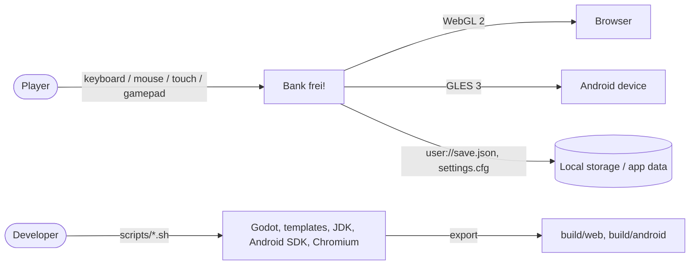
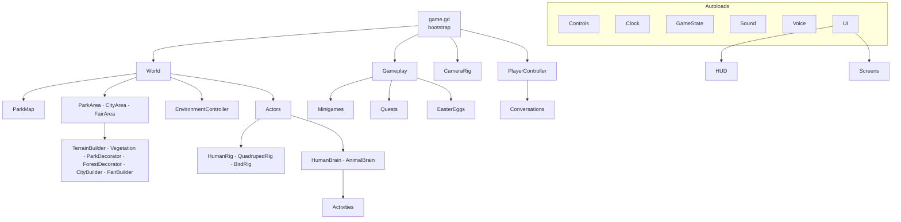
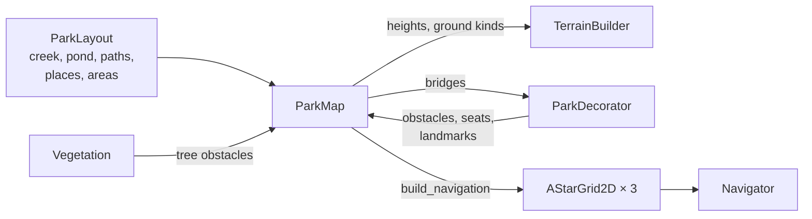
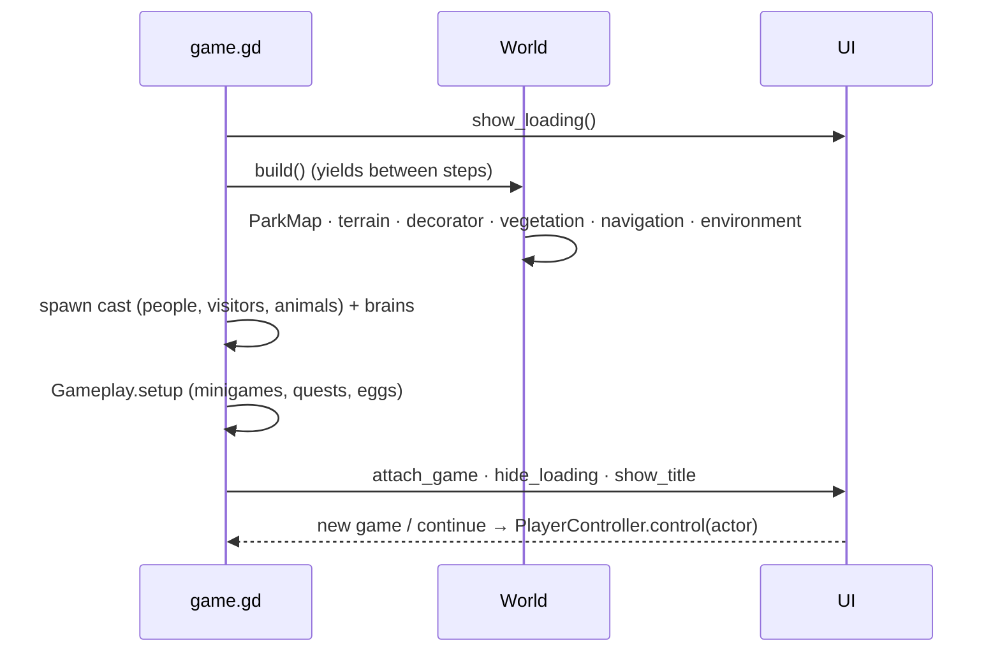
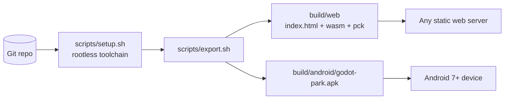

# Bank frei! – Architecture (arc42)

*Bank frei!* is a humorous open-world game set in a big city park. The player
controls one of ~70 people and animals, can switch to any character nearby and
lives a day in the park: eating, resting on benches, playing minigames, earning
money and discovering secrets. Everything that is not controlled by the player
lives its own life driven by needs and daily schedules.

UI language is German; code and documentation are English.

---

## 1. Introduction and goals

### 1.1 Requirements overview

| Area | Requirement |
|------|-------------|
| Platforms | Web (browser, WebGL 2) and Android, one code base (Godot 4.7) |
| World | Large park (260 × 180 m), the Nordwald north of it, the Oststadt (520 × 360 m, cars, the Kastanienallee with four lanes) east of both and the Westpark with the Kirmes (260 × 180 m) west of the park, with creek, pond with island, bridges, pavilion, fountain, playground, food court and food carts spread over the park, dog meadow, many benches, city skyline |
| Characters | Named people and animals with detailed, generated low-poly models; play any of them, switch to characters in range with a smooth camera transition |
| Life | Non-controlled characters follow needs (hunger, fatigue, joy), likes and schedules; good pathfinding |
| Needs | A very hungry or tired player slows down (NPCs keep their pace); sad characters slump and emit sad smileys |
| Gameplay | ~50 minigames, rides and jobs, quests, money, Kirmes tickets, inventory and crafting, achievements, easter eggs |
| Atmosphere | Day/night, weather, four seasons, procedural sound |

### 1.2 Quality goals

| Priority | Goal | Scenario |
|---|---|---|
| 1 | **Runs in the browser and on phones** | Web build starts without special server headers; a mid-range phone renders the park at playable frame rates |
| 2 | **Believable life** | Over a simulated day nobody is permanently stuck; people use paths, eat when hungry, go home in the evening |
| 3 | **Coherence** | One visual style (flat-shaded vertex colours; people smooth-shaded), one data source for the park layout, one input model for all characters |
| 4 | **Testability** | Logic, scenario tests with real input for every feature, a scripted play-through and a reproducible simulation run headless; the web build is screenshot-tested |

### 1.3 Stakeholders

| Role | Expectation |
|---|---|
| Player | Fun, readable German UI, works with mouse/keyboard, touch and gamepad |
| Developer (repo owner) | Reproducible rootless toolchain, one-command build and test, understandable code |

---

## 2. Constraints

- **Godot 4.7, GDScript only**, *Compatibility* renderer (WebGL 2 / GLES 3) for web and Android.
- **No imported art assets**: all meshes, textures, icons and sounds are generated at runtime.
- **Rootless VPS**: toolchain (Godot, export templates, JDK 17, Android SDK, Chromium for tests) installs into
  `~/.local/opt/godot-park` without `sudo` (`scripts/setup.sh`).
- **Single-threaded web export** (`variant/thread_support=false`): no `SharedArrayBuffer`, no COOP/COEP headers needed.
- Android export uses the pre-built APK template (no Gradle/NDK), debug-signed.

---

## 3. Context and scope



The game has no network communication. Persistent data is the save game (JSON) and
settings (ConfigFile) in `user://` (IndexedDB on the web, app storage on Android).

---

## 4. Solution strategy

| Problem | Approach |
|---|---|
| No asset pipeline, small download | **Procedural everything**: `MeshKit` builds flat-shaded vertex-coloured meshes from primitives; characters are `Skeleton3D` + one rigidly skinned mesh; sounds are synthesised into `AudioStreamWAV` |
| Performance on web/phones | MultiMesh batching per chunk (`InstanceBatcher`), visibility ranges, one draw call per character, animation LOD, a pool of 6 lamp lights at night, quality presets |
| Coherent park | `ParkLayout` (static data) → `ParkMap` (derived grids: height, water distance, ground kind, obstacles) → everything else (meshes, navigation, placement) reads `ParkMap` |
| Pathfinding | `AStarGrid2D` on a 1 m grid with per-cell costs (paths cheap, grass expensive) + cost-aware string pulling; separate grids for humans, animals and swimmers |
| Living park | Utility AI for people (needs × likes × schedule × role routine), state machines for animals; activities are small reusable objects |
| Seasons/weather | Global shader uniforms (`season_tint`, `snow_amount`, `foliage_amount`, …) drive all materials; no mesh rebuilds |
| Testing | Headless unit tests, scenario tests that play with real input, accelerated simulation with statistics and invariants, Playwright screenshots of the web export |

---

## 5. Building block view

### 5.1 Level 1



| Directory | Responsibility |
|---|---|
| `src/autoload/` | `Controls` (input map, touch mode), `Clock` (time, seasons, weather), `GameState` (money, stats, achievements, save/load, settings), `Sound` (synthesiser, ambient loops), `Voice` (recorded voice lines from `assets/voice`, doc/voices.md) |
| `src/core/` | `ParkLayout` (design data), `FairLayout` (the Westpark's design data), `ParkMap` (derived grids, bridges, obstacles, nav grids), `Navigator` (path queries), `Cast` (all characters), `Achievements` |
| `src/models/` | `MeshKit`, `Materials`, `NatureModels` (trees, plants), `PropModels` (benches, landmarks, stands, city, items, easter-egg models), `CityModels`, `CarModels`, `TownProps` (gardens, street furniture), `FairModels` (rides, booths, halls, string lights) |
| `src/shaders/` | `solid`, `foliage`, `ground`, `water`, `glow`, `sky` + shared include |
| `src/world/` | `World` (build orchestration and registries), the areas (`areas/`: `Area` and one class per area), builders on `WorldBuilder` (ground height, directions, single meshes, signs, benches, picnic tables, an own RNG per part) with `TreePlanter` for trees, `EnvironmentController`, `InstanceBatcher`, `MapImage`, `Projectile` |
| `src/actors/` | `Actor` (movement, sitting, items, leash), `Needs`, rigs and `RigBuilder`, `EmoteIcons` |
| `src/ai/` | `Brain`, `HumanBrain`, `AnimalBrain`, `Activity`, `Activities` |
| `src/interact/` | `Interactable`, `Seat`, `Bench`, `Shop`, `Food`, `Bottle`, `FunctionSpot`, `StashSpot` |
| `src/game/` | `Game` (`game.gd`), `PlayerController`, `Conversations`, `Gameplay`, `QuestModule` and the quest modules (`Quests`, …), `QuestMarkers`, `EasterEggs`, `TaskBoard`, `DevOptions`; Nordwald: `Gathering`, `Crafting`, `DwarfQuests`; Oststadt: `DriveIn`, `Cinema`; Westpark: `FairPass` (stamp card), `FairTrade` (tickets, lottery, prize counter), `FairStories` (figures, quests, secrets) |
| `src/vehicles/` | `Car` (kinematic car, safety brake), `CarDoor`, `CarSpecs` |
| `src/minigames/` | `Minigame` base, `BallSim` and the games: three in the Nordwald, twelve in the Oststadt (the driving jobs share `DriveJob`), in the Westpark seven rides (`Ride`), seven booth games (`BoothGame`), three arcade machines (`ArcadeGame`) and `AlmondShift` |
| `src/ui/` | `UI` autoload, `Hud` (need bars: `NeedBar`), `TouchControls`, `MapScreen`, `TasksScreen`, `UiTheme` |
| `tests/` | Unit tests (`tests/unit`), scenario tests (`tests/scenarios`, `tests/scenario.gd`), web screenshot script (`tests/web`) |

### 5.2 Park data pipeline



`ParkMap` computes on a 1 m grid (261 × 361 vertices: the city park from z = −90 to 90 and the
Nordwald from z = −270 to −90; `ParkMap.in_park` is the city park, `in_world` both):

- **water distance field**: rasterised per creek and brook segment (bounding boxes only) plus an ellipse distance for the two ponds and the island;
- **heights**: gentle hills + shore profile + levelled plazas;
- **ground kinds** (grass, path, gravel, sand, water, bank, plaza, trail, bridge, stepping stones, rock); first per cell, then areas, plazas and walk structures within their bounding boxes (a per-cell loop over all of them cost 1.3 s at this size);
- **bridges**: detected automatically where a path crosses the creek, spanning until the ground is level again across the whole deck width (creeks are crossed at an angle); the deck is flush with the ground at both ends;
- **obstacles**: flags per cell (bit 0 blocks people, bit 1 animals), added by decorator and vegetation;
- **path surfaces** (`TerrainBuilder`): smooth strips along each path (mitred at bends, round open ends, clipped exactly at bridge ends, curbs on main paths); the 1 m path cells under them are drawn as grass so no staircase shows at the edges;
- **surface patterns** (`src/shaders/surface.gdshader`): the game has no image textures; paths, curbs, plazas, sidewalks, streets, bridges and tree bark get procedural patterns in the shader (pavers, gravel, forest earth, curb joints, plaza stone rings, asphalt, planks, cobbles, masonry, bark), one MeshKit surface per pattern (`Materials.PATTERNS`). Path strips carry UV (u = metres along the path, v = metres from the middle) so pavers follow the path; round plazas carry the offset from their centre; bridges and trunks use their local coordinates; gravel, earth and asphalt use world XZ. The foliage shader adds leaf clusters or needles (`leaf_pattern`, on the unswayed position so it does not swim in the wind), the ground shader blade streaks and clover in the grass. Detail fades out by pixel footprint (`detail()`), so distant paths stay calm and cost little;
- **fair finishes** (`src/shaders/fair.gdshader`, `Materials.FAIR_FINISHES`): painted boards (grooves, tone per board, worn near the ground), canvas (weave; vertices whose colour alpha is below 1 flutter in the wind, 0 = free edge) and lacquer (alpha 0: gold or steel, `FairModels.METAL`). The web renderer has no reflection probes, so the shiny finishes add a cheap sky reflection (`env()`) as emission. `fair_lights.gdshader`: `bulbs` glow a little by day and chase (a wave along the model's local position); with alpha 0 (`FairModels.STEADY`) they are steady light panels. Flags in the vertex alpha (`MeshKit.use(surface, alpha)`) instead of more surfaces keep a booth at four draw calls;
- **navigation**: three `AStarGrid2D`s (people: weighted to prefer paths; animals: uniform; swimmers: water only).

### 5.2a Oststadt (doc/oststadt.md)

`CityLayout` (static design: street grid, blocks, lots, houses) → `CityMap` (writes ground kinds
street/sidewalk/crossing/lot, obstacles with bit 2 = cars, roof heights into the same `ParkMap`)
→ `CityBuilder` (meshes: ground rectangles merged from the grid, curbs, markings, houses per
block with shop fronts on the shopping streets, lot props) → `CityDecor` (back gardens, the
Apfelwiese and the playground as grass lots with cobbled paths, street furniture, bus stops, lot
details: small things from `TownProps`, trees and play things merged into one mesh per 90 m
area with `MeshKit.add_mesh`, benches batched) → `City` (runtime: cars, drive-ins). The town takes 520 columns of the
grid; its cells are filled only when the town is built (`CityArea`, `World.load_area`), which happens when the player comes within
22 m of the fence (loading screen). Until then everything east of the fence is solid, and the
park shows a cheap backdrop (`EastSurroundings`, `EastBackdrop`) that the town replaces.

Cars (`Car`) are kinematic like actors: a bicycle model on drivable cells; each step checks
the footprint against the map, other cars (separating axes) and people. Before moving, the car
measures the free distance to people ahead and brakes so it stops 1 m before them; a step that
would touch somebody is refused. People in front of a fast player car jump aside
(`Actor.dodge`), and walkers can't step into a car (`Actor._blocked`). The player drives through
`PlayerController` (`enter_car`, `exit_car`); the camera follows further back and pulls in front
of houses (`roof_at`). Car meshes (`CarModels`) are lofted from cross-sections along the car;
paint, lamps, glass, chrome and rubber share one surface of `car.gdshader` (vertex-alpha flags),
so a car is one draw call; beyond `Car.NEAR` (45 m) a version without small details is shown.

Driving jobs (`DriveJob`) guide the player with `RouteArrow`: `CityRoute` runs Dijkstra over the
crossings (a U-turn costs 35 m, a lot is left by its driveway) every 0.4 s, and the arrow is
painted on the road in front of the car along that route, in the car's lane; half a block before
a turn it bends into the lane of the cross street (`RouteArrow.lane_offsets`: on the
Kastanienallee the outer lane after a right turn, the inner one after a left turn); the panel
shows the metres left and the next turn ("in 40 m rechts").

A driving job goes with its vehicle: its start spot follows the player's car of the job's kind
(`FunctionSpot.anchor_fn`, `Interactable.background`: any other spot in reach wins), so a taxi
shift starts anywhere in a taxi, whatever Tanja is doing; the host only speaks over the radio
(`DriveJob.radio`: the panel's line and `Voice.radio`) at the start, at every step, after hard
bumps and in the result; a taxi passenger speaks the same way with their crowd voice
(`DriveJob.passenger_line`). Where the host gives the order (`needs_order`: Bodo's deliveries, Egon's
rally) the player takes it on foot (`host_options`) and the job starts on getting into the
vehicle (`Gameplay.vehicle_entered`). Friedrich's lessons and Toni's pump game still need them
there (`host_needed`, `host_near`).

`Traffic` builds a lane graph over the grid (one lane each way per street segment, two on the
Kastanienallee: the inner one straight on or left, the outer one straight on or right;
right-hand traffic) and drives about 22 AI cars: pure pursuit along lane → turn curve → next lane, cruise and turn
speeds, a stop line per crossing. A crossing is reserved by one car at a time (the first in its
queue, when the light is green, the box is empty and the next lane has room); traffic lights
cycle per axis. Cars measure the gap to cars along their own way. An AI car stuck for long out
of sight is replaced. People of the Oststadt (`Cast.CITY`, passers-by, children) are spawned
when the town loads, live in fixed houses (`World.city_house_of`) and stay in the `"city"` region.

### 5.2b Westpark with the Kirmes (doc/kirmes.md)

The grid is 1040 × 540 cells: columns 0–259 are the Westpark (rows 180–359, z −90…90) and the
Ritterburg north of it, 260–519 park and Nordwald (rows 0–359) with the Möwenbucht south of them
(rows 360–539, z 90…270), 520–1039 the Oststadt (rows 0–359); rows 360–539 outside the Möwenbucht's
columns are the sea beyond the world (always solid). `ParkMap.in_world` covers the three parts; `in_bounds` adds the strip along the fence
between park and Westpark (the fence is an obstacle row with the Westtor gap,
`ParkDecorator._fair_fence`). Like the town, the Westpark is built on demand (`FairArea`)
(near the Westtor with everything loaded, or when the player enters it) runs `FairMap.build`
(pond, heights, paths, ground kinds with the same rules as the park, `ParkMap.compute_heights` /
`raster_paths` / `compute_ground`), `FairBuilder` (terrain chunks, path ribbons and plazas from
`TerrainBuilder`, the rides, halls, booths, oases, fence, trees) and `ParkMap.build_fair_navigation`.
`Fair` (runtime) turns the Ferris wheel (gondolas kept upright), the carousel, swings the chain
swing and the swing boats, runs the coaster train along its track and the ghost-train car, lets
the bumper cars drift; far from the camera it updates every 6th frame. Its trees are
`World.fair_trees`, not `trees` (squirrels, felling and the park's map stay in the park). Until it
loads, and while it sleeps, the park sees `FairBackdrop` (meadow, the wheel, halls and booths
standing still, trees). Houses along its streets (`FairCity`) and the forest north of it
(`WestForest`) belong to the horizon.

### 5.2d Ritterburg (doc/burg.md)

The castle area takes the grid's columns 0–259, rows 0–179 (x −390…−130, z −270…−90), north of
the Westpark and west of the Nordwald. `ParkMap.in_burg`, `burg_ready` / `burg_open` and the
navigator's area `BURG` work as for the other areas; `ParkLayout.area_at` and `region_of` tell
"burg" from "fair" by z. `BurgLayout` holds the design (places, areas, plazas, paths, posts) and
`height()`: the heights come from it instead of hills (`ParkMap.base_height` branches to it): a
flat tournament ground at the foot, a ramp inside the outer wall up to the inner square (7 m),
the top (9 m) behind the inner wall, slopes outside the walls rising to the rock, everything
faded to street level along the borders with the Westpark and the Nordwald. The heightfield has
no slope limit, so the walls (`BurgMap.walls`, obstacles 2.4 m thick) hide the steps between the
castle's hill and the slopes, and the rock behind it is solid ground (`BurgMap._rock`).
`BurgArea` builds `BurgMap` (heights, paths, ground, walls, rock, border fences), `BurgBuilder`
(terrain, walls as one stepped masonry mesh, towers, gate houses, hall, lookout tower, tavern,
smithy, stalls facing the nearest path, the tournament ground with stands whose tiers are
benches, paddock and stable, sword ring, tug pitch, archery range, the inner square with stage,
puppet theatre and magician's corner, torches (flames in one glow mesh, lit at dusk by `Burg`,
the torches are `World.lamps`), banners, trees on the slopes) and `Burg` (posts, game spots).
Until it loads, and while it sleeps, the others see `BurgBackdrop` (the hill as a coarse mesh,
walls, towers, the big buildings, stands). Its people come and go by the west path
(`World.burg_entrances`); at the start of their working hours they stand at their posts
(`Game.place_by_schedule`, the ways up the hill are long). The secret passage (`BurgPassage`) is
a fade to black between a door at the top and one beside the dwarves' mine, the areas swapping
as at a gate. Animals: ravens and falcons (birds, playable, `AnimalBrain.player_flight`: a short
flight with the special action) and horses (`QuadrupedRig` presets with a long neck and a mane,
grazing in the paddock, not playable).
Herbs and potions (phase 2): `HerbSpots` places Gathering spots of kind "herb" (`spot["item"]`)
in every area as it is built (own random sequences; placement reads the cells' flags, not
`is_solid`). `Potions` keeps the buffs in `GameState.buffs` (id -> game hour it ends): the
Lauftrank multiplies `Actor._speed_boost` and turns walking and running into the needs state
"light" (no fatigue), the Kräutertrank doubles herb and berry yields, the Abbautrank halves the
time per hit on trees and rocks (`Gathering`). Brewing and forging are Crafting stations with
a `fee` and an optional `item` (several recipes can make the same item), opened by talking to
the master at work (`BurgTrade`).
Games (phase 3): `BurgHorseGame` lends a horse to a game (its brain state "ridden",
`custom_motion`) and seats the rider ("ride" pose, `SADDLE` above the horse); Tjost and
Ringstechen derive from it. `Burg` runs the joust show on the hour with the same idea and blocks
the riding games meanwhile. A minigame that starts moves a shown achievement below its panel
(`UI.place_achievement`).
Stories (phase 4): `BurgStories` is a QuestModule like FairStories; it reaches into the Kirmes
only through three hooks (Gisbert's talk, the Ferris wheel's top, Esmeralda's hint rows) and
through options for Zambini and Esmeralda. A Crafting recipe with "step": [stat, from, to] is
offered only while a story is at those steps.

### 5.2e Möwenbucht (doc/moewenbucht.md)

The coast takes columns 260–519, rows 360–539 (x −130…130, z 90…270), south of the city park,
through the Südtor (`AreaGates` "gate_coast"); `ParkMap.in_coast`, `coast_ready` / `coast_open`,
the navigator's area `COAST` and `ParkLayout.area_at` ("coast" south of `COAST_EDGE`) work as for
the other areas. `CoastLayout` holds the design and the signed distance to the water's edge
(`land_dist`: the bay's shore line, the harbour's straight quay, the mole, the rocky point, the
sandbank) and `height()` (the strip by the park, the promenade, dunes, the beach falling into the
sea, the sea floor 3–4 m deep). `CoastMap` writes `water_dist` and the heights itself (the park's
shore rule in `compute_heights` would flatten the sea floor), the paths, the ground (sand, water,
the quay's and the mole's stone, solid rock), the decks and the fence to the park. Walkable decks
over water and sand are `ParkMap.decks` (strips from a to b with a height from h0 to h1: the pier
sloping up from the beach, its head, the jetty); `walk_height` asks them south of the park, their
cells are BRIDGE ground. `CoastBuilder` builds the terrain (sand paler than a sandpit, the sea
floor sandy to dark with depth: `TerrainBuilder._ground_chunk`), the promenade, stands, bandstand,
dunes, boardwalks, beach furniture, pier, harbour, mole and lighthouse, rocks, seals, buoys and
the surf (a strip along the water's edge with `surf.gdshader`); `Coast` keeps the boats, posts and
spots and turns the lighthouse's beam at night. The sea itself is part of the horizon
(`CoastBackdrop.horizon`, always shown, also from the other areas): one mesh with `sea.gdshader`
(swells rolling in, deeper blue further out, a sky reflection), finely divided over the bay and
coarser outside (edges on the coarser grid, none north of z 100, where the park's water lies in
the same plane), plus the cliff west of the bay and a harbour town east of it, each mesh built
round its own middle so its view range counts from there (it is measured from the node's origin).
`CoastBackdrop.build` stands in for the bay until it is loaded or while it sleeps.
**Boats** are `Car`s with the spec "water" (`CarSpecs` pedalo, rowboat): the same driving model
and controls, but only on `CoastMap.sailable` water (inside the buoys, deep enough, not on decks,
groynes or the sandbank), other boats as obstacles, no engine sound, a drag that lets them glide,
turning a little on the spot, bobbing (group "bobbing"); the oars and the paddle wheel move with
the speed (`CoastModels.boat_parts`). `PlayerController.exit_spot` lets the driver out of a boat
only onto land or a deck within reach; otherwise there is no "Aussteigen".
Phase 2: `CoastSpots` adds Gathering spots (shells along the water's edge in a batch; fishing
places with a `catch` table, `Gathering.CATCH`; `catch_at` draws the fish), `BoatFishing` is an
Interactable used from a vehicle (`from_car`) that lets the player fish from a rowing boat lying
still; the stands are `Shop`s (`Coast.SHOPS`) run by the coast's people (`Cast.COAST`).

### 5.2c Playground (doc/playground.md)

`Playground` (`src/world/playground.gd`, built by `ParkDecorator`, `World.playground`) owns the
equipment: static parts merged into one mesh; moving seats (swings, nest swing, seesaw, carousel,
spring animals) as World seats whose riders it places every frame on the moving carrier node
(`riders`, `_carry`); scripted motions (`use()`: slide, climb, jump, balance) that drive an
actor with `custom_motion`. The player uses them through `Bench.verb` prompts and device
`FunctionSpot`s, children through `Activities.Play`. `PlaygroundQuests` (the gang's wishes,
Bruno's chest) and the games `SwingGame`, `TrampolineGame` and `SandDigGame` (free roam) build on
it; `PlaygroundModels` has the meshes. The area keeps the ring path paved through it
(`AREAS` flag `keep_paths`); its sand patches are areas with `"flat": false`.

### 5.3 Characters

```mermaid
classDiagram
  class Actor {
    needs: Needs
    rig: Rig
    brain: Brain
    go_to() sit_on() stand_up()
    consume() play_anim() say()
  }
  Actor --> Needs
  Actor --> Rig
  Actor --> Brain
  Rig <|-- HumanRig
  Rig <|-- QuadrupedRig
  Rig <|-- BirdRig
  Brain <|-- HumanBrain
  Brain <|-- AnimalBrain
  HumanBrain --> Activity
  Activity <|-- Wander
  Activity <|-- Sit
  Activity <|-- Eat
  Activity <|-- Jog
  Activity <|-- Feed
  Activity <|-- Perform
  Activity <|-- Work
  Activity <|-- "… 12 more"
```

- **Rigs** build a `Skeleton3D` with identity rest rotations and one skinned mesh (rigid skinning,
  one bone per vertex). Animation is procedural: each frame the rig sets target rotations per bone
  for the requested state (walk cycle, sit, eat, phone, photo, dance, …) plus mood overlays (sad
  posture, tired slouch), and blends towards them. Faces have blinking eyes and happy/sad mouths.
  People are rounder than the low-poly world: `MeshKit.detail` gives their round primitives
  more segments and `MeshKit.smooth` exact normals (smooth shading; boxes and caps stay flat),
  the `character` material wraps the light round the body with a soft rim. Big heads and eyes
  with a highlight, round hands and slightly sturdy limbs (`HumanRig.LIMB`, `EYE`); about
  10 000 vertices and ~13 ms to build per person (natively, Oct 2026).
- **Actor movement** is kinematic: waypoint following, grid collision with sliding, soft separation
  between nearby people and dogs, terrain/bridge/pier height, swimming for ducks.
- **HumanBrain** scores candidate activities: `need pressure × personal like × noise`, plus a role
  routine (vendor at the stand, performer at the pavilion, gardener, dog sitter, chess player) and
  the visiting schedule (people arrive through a gate and go home). Rain sends people to shelter.
  Workers with a post (vendors, hosts, performers, the chess player) come early by their way from
  the gate nearest the post (`commute_hours`), go straight to work and stay there all working day
  (a packed lunch at the post). NPCs never slow down from hunger or fatigue, and walk briskly on
  long ways (`Actor._brisk`): at ~66 m per game hour a walk across the park takes hours.
- **AnimalBrain** is a per-species state machine (dogs on leash/off leash/fetch, cats stalking mice
  and climbing trees, mice hiding in holes, ducks swimming and following their mother, squirrels
  climbing and stealing donuts, pigeons flying off, heron fishing, night animals).

### 5.4 Gameplay

`Gameplay.setup` wires the games and quest modules once the park is built; the start spots of the
Oststadt's and the Westpark's games follow when those are loaded (`setup_city`, `setup_fair`).

- **Minigames** (`Gameplay.minigames`, ~50): the `Minigame` base handles start/end, entry fee,
  rewards (joy, money), the camera take-over (or `free_roam`: the player keeps walking), a HUD
  with info, score, power bar and touch buttons, `primary_pressed`/`clicked` for the main button
  (Aktion, space bar, click) and `end_after` for a delayed end. A game says itself when its
  notebook goal is reached (`goal_done`) and what its host offers (`host_options`, `talk_option`);
  whether the host must be there (`host_needed`, `host_near` to the start spot). Families
  share a base: `DriveJob` (the Oststadt's jobs), `Ride`, `BoothGame`, `ArcadeGame`.
- **Conversations**: talking to a character offers chat, petting, switching and the options of
  all providers (`Conversations.register`): minigame hosts and the quest modules. A follow-up
  dialog from an option's action opens with `UI.dialog_then`.
- **Quest modules** (`QuestModule`, listed in `Gameplay.modules`): `Quests` (dog walking, the
  mime, the bridge troll's riddles), `DwarfQuests`, `FairStories` (Westpark), `PlaygroundQuests`.
  Each says what its characters offer (`options`), its notebook entries (`tasks`) and under whom
  a quest ring glows (`quest_givers`, `has_quest`). More game systems with their own dialogs and
  notebook entries: `Gathering` and `Crafting` (Nordwald), `DriveIn` and `Cinema` (Oststadt),
  `FairPass` and `FairTrade` (Westpark).
- Notebook entries (`TaskBoard`) carry an `area` (`TasksScreen.AREAS`: park, forest, city, fair;
  minigames by `Gameplay.area_of_game`). The notebook (`TasksScreen`) filters tasks and residents
  by area and tasks and achievements by open/done; it opens on the player's area.
- `QuestMarkers`: glowing rings (`quest_ring.gdshader`) near the player under quest givers with an
  open quest, unfound gnomes (gold) and minigames whose notebook goal is open (blue).
- `EasterEggs`: 7 hidden garden gnomes, wishing fountain, duck statue and the "quak" code, Nessie,
  UFO, Nussi's donut stash, bench plaques.
- `GameState` keeps money, tickets, stats, sets and flags; achievements unlock automatically when
  a stat reaches its target.

Adding content:

| What | Where |
|---|---|
| Character | an entry in `Cast.PEOPLE` / `FOREST` / `CITY` / `FAIR` (looks, likes, hours, role, work, greetings `greet`); a work post in `ParkLayout.POSTS` / `CityLayout.POSTS` |
| Item | `Items.DEFS` and its icon in `ItemIcons.draw`; edible: its effect in `Food.ITEMS`; held in the hand: `PropModels.item()`. Giving one: `Actor.room_for` (says when the bag is full), then `add_item` |
| Shop | an entry in `Shop.SHOPS` (title, menu, goods, buys, calls); the vendor is whoever has it as `work.shop` in `Cast` |
| Minigame | a class extending `Minigame` (`title`, `host_id`, `cost`, `describe`, `goal_done`, `begin`, `game_input`, `cleanup`; `rng` for its randomness), its entry in `Gameplay.setup` and a start spot (`ParkLayout.GAME_SPOTS`, `CityLayout.GAME_SPOTS`, or placed by its area; the prompt gets the price); stats it writes and an achievement |
| Quest | a module extending `QuestModule`: `options` (quest steps marked `"quest": true` get the gold ring), `tasks`, `quest_givers`, `talked`; its state as stages; `thank` when done; added to `Gameplay.modules` |
| Achievement | an entry in `Achievements.DEFS` (stat and target); the game writes the stat |
| Always | a scenario test and a row in `doc/test-scenarios.md` |

The planned simplifications of these steps are in [todo.md](todo.md).

---

## 6. Runtime view

### 6.1 Start-up



### 6.2 An NPC gets hungry

1. `Needs.update` raises hunger every frame (game minutes).
2. When idle, `HumanBrain._choose` scores `Eat` high (`(hunger/100)² × 6 × like`).
3. `Activities.Eat` walks to an **open** shop (vendor present and at the counter), waits, is served,
   then uses `Activities.Sit` to find a table or bench and plays the eat animation.
4. On finish `Food.apply` lowers hunger and raises joy; sometimes the visitor drops a deposit bottle.

### 6.3 Switching characters

`PlayerController.control(new)` resumes the old actor's brain, suspends the new one's, lets the
camera interpolate from the old focus to the new one (1.2 s ease) and records the character for the
"Verwandlungskünstler" achievement. Only characters within 25 m that are on screen can be chosen.
Every switch, from the menu or by talking, asks first (`UI.confirm_switch`, "Abbrechen" has the
focus). The bag is the player's (`GameState.inventory`): `control` hands that dictionary to the new
actor, adds what they carried and leaves the old one an empty bag.

---

## 7. Deployment view



- Web: static files, single-threaded build, served by any HTTP server.
- Android: debug-signed APK (arm64-v8a, x86_64), landscape, immersive mode.
- Production: push to `main` → VPS webhook builds the `Dockerfile` (Godot headless export inside the
  build stage, nginx on port 3000) → https://godot-park.ironstrike.de. Other branches → previews.
- The same image serves the Android APK (`/download` page, `/bank-frei.apk`), built in the Docker
  build stage with a minimal Android SDK and signed with the committed `deploy/bank-frei.keystore`.

---

## 8. Cross-cutting concepts

### 8.1 Coordinates and units
Metres; `Vector2(x, z)` for ground positions, `+x` east, `+z` south. Yaw 0 faces `+z`
(`forward = (sin yaw, 0, cos yaw)`). Models face `+z`.

### 8.2 Rendering style
Flat shading through per-triangle normals; vertex colours are converted to linear at build time.
Materials are shared by surface name (`solid`, `foliage`, `evergreen`, `cherry`, `grass`, `flower`,
`glow`, `water`, `ground`, `character`, the surface patterns, the fair finishes `boards`, `canvas`,
`lacquer`, the fair lights `bulbs` and `car` for the cars' paint, glass, chrome and rubber). `MeshKit.tri_c`/`quad_c` set a colour per corner (the
canvas flutter weight in alpha); `MeshKit.use(surface, alpha)` writes a per-vertex flag. Global uniforms implement seasons (tint, falling foliage,
blossoms, snow, ice), wetness and night glow.

### 8.3 Time
`Clock`: one real second = one game minute (a day lasts 24 minutes), three days per season.
Needs, schedules, shop hours, night animals, Nessie and the UFO depend on it. Cooldowns in
seconds use `Clock.now()` (seconds of play: stops in the pause menu, follows the speed-up),
never the wall clock; timers that belong to the game pause with it (`create_timer(t, false)`).
Randomness comes from the global RNG or RNGs seeded from it (`Minigame.rng` at every start), so
the dev option `seed=N` repeats a run.

### 8.4 Input
`Controls` registers all actions at runtime (keyboard, gamepad). Touch mode switches on with the first
touch and shows the virtual joystick and buttons. Tap/click on the ground walks there (path-finding),
tap on a character talks to it. Dialog options are reachable with number keys. Things and people
have their own action: "Aktion" (E / A) uses the best thing in reach (bench, stand, car, spot) and
talks only when nothing else is there, "Ansprechen" (T / B, thumb button) talks to the person in
front (`PlayerController.focus` / `talk_focus`); the HUD prompt shows both. Switching characters
is Q / Tab / Y, on touch the "Wechseln" button in the top bar. In a car "Aktion" is for spots used
from the car (drive-in, cinema, jobs) and gets out only where there is none; "Ansprechen" always
gets out (touch: "Aussteigen", plus a button named after the spot left of the pedals).

### 8.5 Persistence
`GameState.save_game()` stores money, tickets, stats, sets, achievements, controlled character,
actor needs, the player's bag and the clock as JSON every minute and on achievements; settings live
separately. All progress is numbers in `stats` or members of `sets`, so an achievement can wait
for any of it: counters and bests, quest stages (`GameState.stage`/`set_stage`, simple quests go
`QuestModule.OPEN` → `ACTIVE` → `DONE`) and once-a-day things (`done_today`/`mark_today`, the
day + 1). The save carries `GameState.VERSION`; `GameState.migrate` brings an older save up to
date when it is loaded (version 1 kept quest states as flags). Renaming a stat or item id needs
a new version and a migration step.

### 8.6 Localisation
All user-facing strings are German string literals next to the code that uses them (no runtime
language switch is required). Glyphs are limited to what the default font supports.

### 8.7 Performance
Instanced vegetation per 60 m chunk with visibility ranges (grass 45 m), character meshes hidden
beyond 140 m and animated at 10 Hz beyond 45 m, small animals skip avoidance, a light pool for lamps,
quality presets (shadows, MSAA, 3D render scale).

Simulation level of detail (CPU, which bounds the frame rate on phones):
- `World.focus` is where the camera looks. `Actor.lod_step()` updates actors every frame within
  50 m, every 2nd / 4th / 8th physics frame beyond 50 / 100 / 160 m, with the skipped time added
  up (never more than 0.15 s at once). Poses of actors off screen are not computed.
- Neighbour queries go through bucket grids rebuilt once per physics frame:
  `World.actors_near` (8 m buckets) and `City.cars_near` (10 m, ~170 cars). Nothing loops over
  all actors or all cars per frame any more (separation, car safety brake, cars in a walker's way,
  the traffic's gap and crossing checks).
- `Traffic` rests (AI cars disabled) while the focus is more than 30 m west of the town.
- NPCs check whether to break off an activity four times a second, not every frame.
- Measured headless on the VPS (CPU per frame): park 21 → 8 ms, park with the town loaded
  49 → 9 ms, in town 51 → 8 ms. The overlay (Einstellungen → Leistung anzeigen) shows FPS, frame
  and script time, draw calls, triangles and active actors on a real device.

### 8.8 Areas
The world has five areas: the **park** (with the Nordwald, −130 ≤ x ≤ 130, z ≤ 90), the
**Oststadt** (x > 130), the **Westpark** with the Kirmes (x < −130, z ≥ −90), the **Ritterburg**
(x < −130, z < −90) and the **Möwenbucht** (−130 ≤ x ≤ 130, z > 90). Each is an `Area`
(`src/world/areas/`: `ParkArea`, `CityArea`, `FairArea`, `BurgArea`, `CoastArea`, in `World.areas`) that knows how it is built (`_build`: map
cells, navigation, scenery under its `root`, its runtime node), how it sleeps and wakes
(`set_awake`: its `ParkMap` switch, `root` and runtime hidden and disabled, its backdrop, its
people), its people (`cast`) and its texts (loading screen, the gate's question). The town and
the Westpark are built on demand (`World.load_area`, then `World.area_loaded`: the game spawns
the area's people, `Gameplay` its game spots). Every actor belongs to one (`World.home_area`;
`Actor.home_region` also tells the Nordwald from the park) and never leaves it on its own
(`World.allowed`). A new area is a subclass of `Area` plus its layout, map writer, builder and
cast; its bounds go into `ParkLayout.area_at` (World.area_of, region_of, the navigator),
`ParkMap.in_world` / `in_bounds` / `is_solid` and its grid rows and columns.

- Setting **Bereiche** (`GameState.settings.areas`, `Game.split_areas`): `split` keeps only the
  player's area awake, `all` keeps every area once built, `auto` splits on phones and tablets
  (Android, mobile web) and keeps all on PCs. Scenario runs default to `all` (dev option `areas=`).
- **Split**: at a gate a dialog asks: the Osttor and the forest gate east (park ↔ town), the
  Westtor (park ↔ Westpark), the Waldweg (Nordwald ↔ Burg), the Burgpforte (Westpark ↔ Burg) and
  the Südtor (park ↔ Möwenbucht).
  `AreaGates.GATES` has each gate's position, the axis it is crossed along and the areas on its
  two sides, so a gate joins any two areas across a north-south or an east-west fence; the texts
  come from the areas. On yes the other areas fall asleep and this one
  wakes up behind a loading screen (`World.enter_area`). Being put into another area (switch, dev
  option, test teleport) swaps without asking.
- **Sleeping** means hidden and not processed, not freed: the park's scenery lives under one node
  (`World.seal_park`, `park_root`), the town under `City` and `Static/Oststadt`; their people are
  `Actor.dormant` (hidden, `PROCESS_MODE_DISABLED`, counted as inside); `ParkMap.park_open` /
  `city_open` make the sleeping area solid. Memory stays (~260 MB with both built); draw calls,
  triangles and simulation of the other area are gone (CPU headless: park 11 → 8 ms, town
  12 → 6.5 ms).
- **Waking** is a fresh start of that area: everybody is placed by the time of day
  (`Game.place_by_schedule`, as at the start); positions and doings from before are not kept.
- **Views across the border**: from the park the cheap `EastBackdrop` (low houses, parked cars)
  stands where the town is, `FairBackdrop` where the Westpark is, `BurgBackdrop` where the
  castle is and `CoastBackdrop` where the bay is (the sea is always there); from the town and the
  Westpark `WestBackdrop` (coarse ground, ~50-triangle trees where the real trees stand, the
  fences) stands for the sleeping park.
- **In every mode** what belongs to an area stays there when the player crosses: the dog walk ends
  (the dog stays), every leash is let go, a game of the other area ends (`AreaGates.leave_behind`);
  cars can't leave the town (only town ground is drivable) and get a hint at the gates. A character
  the player lets go of outside its area goes home (`World.send_home_if_lost`). Collected items stay
  in the bag.
- **Not split**: within 10 m of a gate (or a metre from the border) the area beyond is built in
  time, so walking through is seamless (`AreaGates.approaching`).
- **Map of areas not loaded**: `MapImage` draws the park at runtime (felled trees change it) on top
  of a baked image of the whole world (`assets/map/world.png`, 156 KB, made with every area built
  by `scripts/bake_map.sh`, dev option `bake_map=`); the Oststadt and the Westpark come from it
  until they are loaded and are drawn anew then. So their maps and the "Gesamtkarte" (all areas,
  their names, the player; a tap opens that area's map) work in split mode too. `release.sh`
  re-bakes when one of the inputs listed in `bake_map.sh` changed;
  `areas::test_baked_map_is_up_to_date` compares the baked parts with the drawn ones. A tap on
  the map into a sleeping or unloaded area walks to its nearest gate (there the gate asks).
- Not done (yet): freeing a sleeping area's memory.

### 8.9 Testing
| Level | Tool | What |
|---|---|---|
| Unit | `tests/test_runner.tscn` | park map, navigation, needs, achievements, items, tic-tac-toe AI, ball physics, clock, cast/rigs |
| Scenario | `scripts/scenario.sh` (`tests/scenarios/*.gd`, base `tests/scenario.gd`) | ~385 tests in 40 files that play the game natively and headless with real input (actions, keys, clicks, touch taps, dialog choices) from defined start states, one Godot process per file, three at once; catalogue with status per feature in [test-scenarios.md](test-scenarios.md) |
| Simulation | `--stats=1 --speed=6 --seed=1 --city=1` | half a day of park and town life, reproducible; fails on script errors, invariant violations (money, needs, positions, regions, water, seats, vendors at work, leashes) or too many stuck walkers |
| Visual | `scripts/web_test.sh` | exports web, renders presets in headless Chromium (screenshots only, no input), checks console errors; `perf`: draw-call budgets |

Native test runs use `--fixed-fps` (deterministic steps, faster than real time) and start Godot
through `scripts/godot.sh`, which caps its memory. Dev options `seed=N` (reproducible randomness;
scenario tests reseed per test from it and the test's name) and `save=<name>` (own, fresh save
and settings files) keep runs independent. Gameplay code measures time with `Clock.now()`, never
the wall clock, so a run doesn't depend on the machine's load.
`scripts/test.sh` imports once, then runs the unit tests and the scenario files with the
simulation next to them (~7 min); `WEB=1 scripts/test.sh` adds the screenshots.
`scripts/release.sh` runs the unit tests and the scenario files that cover the changed paths
(`scenario.sh --changed`, map in `tests/scenario_map.txt`; `FULL=1`: everything) before it pushes.
The simulation also checks the life that takes game hours (people stay in their area, vendors at
their stands, leashes); scenario tests keep the precise moments. Scenario tests put the Oststadt
and the Westpark to sleep before every test unless it asks for them (`city()`, `fair()`).
`scripts/web_test.sh perf` holds the draw calls at fixed spots to a budget.

---

## 9. Architecture decisions

| # | Decision | Rationale | Consequence |
|---|---|---|---|
| 1 | Procedural models instead of imported assets | No asset pipeline, tiny download, consistent style, easy variants (seasons, duck hats) | Model code is long; visual tweaking needs code changes |
| 2 | Kinematic movement on a grid, no physics engine | Deterministic, cheap, works identically on web | Collisions are approximate (cell resolution 1 m) |
| 3 | `AStarGrid2D` with weighted cells + string pulling | Fast native A*, paths preferred naturally, no navmesh baking on the web | Smoothing must check clearance; cost-aware shortcuts |
| 4 | Utility AI + activity objects | Easy to add behaviours, readable "doing" text for the UI | Tuning weights is empirical (simulation stats help) |
| 5 | Skinned single-mesh characters | One draw call per character | Rigid skinning only (no deformation), fine for low-poly |
| 6 | Compatibility renderer, single-threaded web build | Runs everywhere, no special hosting headers | No SDFGI/volumetrics; effects implemented in simple shaders |
| 7 | UI built in code | Consistent theme, no hand-written scene files | No visual editing in the Godot editor |

---

## 10. Quality requirements

| Scenario | Measure |
|---|---|
| Half a day of simulated life (6× speed) | 0 script errors, < 50 stuck-walker events, most actors not sad/starving |
| Scenario tests | Every feature has a test that plays it with real input; every character of all areas can be talked to without script errors |
| Web start | Loading screen with progress; no console errors in headless Chromium |
| Phone | Touch controls usable, quality preset `medium` by default |

---

## 11. Risks and technical debt

| Risk | Mitigation / note |
|---|---|
| Web start-up time (park generation in GDScript, ~1–3 s) | Loading screen with progress; generation could be baked to resources later |
| Swiftshader-based tests don't show real GPU performance | Use the performance overlay (Einstellungen → Leistung anzeigen) on real devices |
| Achievement "Bankdrücker" relies on bench ids staying stable | Bench ids are generated deterministically (seeded RNG) |
| Areas sleep but stay in memory (no unloading) | The Westpark is built on demand like the Oststadt (its own builder); a sleeping area keeps its nodes. Next step if memory gets tight on phones: free a sleeping Westpark or town and rebuild it on return |
| Many actors with avoidance in crowded spots | Separation only within 45 m of the camera, neighbours from the bucket grid |
| Android emulator (SwiftShader in Docker) renders nothing, even for an empty Godot project (shader uniform limit 261) | `scripts/android_test.sh` verifies install, start, world build, runtime stability; visuals must be checked on a real device |
| Generated audio buffers: the mixer reads one sample past the end | Fixed by padding every generated `AudioStreamWAV` (found as a SIGSEGV on Android) |
| No Play Store AAB | The APK is release-signed with the committed `deploy/bank-frei.keystore` (stable signature for updates); an AAB would need a Gradle build with NDK and the Android source template |
| Content is wired in several places (quest markers, stat ids as literals, areas by hand) | The ordered list of simplifications is in [todo.md](todo.md): test net first, then the content APIs, areas, actors, structure, performance |

---

## 12. Glossary

| Term | Meaning |
|---|---|
| Actor | Any person or animal in the park |
| Brain | Decision logic for a non-controlled actor |
| Activity | One behaviour unit of a person (walk somewhere and do something) |
| Rig | Generated skeleton + skinned mesh + procedural animation of an actor |
| ParkMap | Runtime grids derived from `ParkLayout` |
| Seat | A place to sit (bench, table, stool, swing, blanket; on the playground also nest, seesaw, carousel, spring, which move their rider) |
| Bank frei! | Working title, German for "bench free!" |
